# Shader milestone 1: lighting, water and sky baseline

**Status, 2026-10-18 evening:** round 14, critic 6 out of 10 (from 5.9 at r05). The gate is
not passed: golden hour 5, and the rest of Tier A at 6-7. The full history is in the
[rounds log](#rounds-log-2026-10-18-afternoon-session) at the end.

- **Fixed today:** auto-exposure now adapts. It had read a colortex5 up to 26 frames old
  (buffer ping-pong; `prepare1` makes the flip count even) and froze at high fps (log
  exposure in hi/lo halves). The sky-view table now has its horizon (`pi - beta`). The
  torch tunnel is at 0.20 mean luma (vanilla 0.17). Nights follow the owner's round-0
  answer (0.047), with a distance fade. Golden-hour views are retimed to a sun that is really low.
- **Every preset is inside its budget:** High 0.93 ms, Low 0.47 (budget 0.9), Potato 0.36 (budget 0.4).
- **The owner's taste profile** (round 0) is at the end of [`look-bible.md`](look-bible.md).
  The survey image set is from `tools/shaders/review/calibration.py`.

Written from scratch for Angelica's Iris backport; no code, ID tables or option names
from Complementary or any other pack ([`LICENSES/`](../../../shaders/QuestForge/LICENSES/)).
Every program starts with the `IS_ANGELICA` guard.

## Iterating first thing

The dev pack is a junction from the Angelica test client into the repo, so an edit in
the repo is live after F9.

1. Check nobody else holds the client: `py -3.10 -I tools/trial/trial.py status`.
   If it lists a client, wait.
2. Start `C:\qfb\client-ang2\LAUNCH-ANGELICA.bat` (the full pack on Angelica; 3–5 min to
   the menu).
3. Open a world, press **F8**, pick **QuestForge-dev**, Done. **Options** on that screen
   holds the preset (Potato … Ultra; Medium is the default), Night Brightness, Exposure,
   Waving and the debug views.
4. Edit any file under `shaders/QuestForge/shaders/`, then press **F9** to reload. A
   compile error shows in chat with the line (`enableDebugOptions=true` is set); the
   GLSL as Angelica rewrote it is in `C:\qfb\client-ang2\patched_shaders\`, so read
   that when a line number doesn't match.
5. Before F9, `py -3.10 -I tools/shaders/check_glsl.py` compiles every program on every
   preset offline in about 10 seconds (Khronos glslang), so errors cost no reload.
6. **F4** toggles shaders, to compare with vanilla.

**If `client-ang2` misbehaves.** It runs the full pack, and tonight's rounds ran only on
the slim trial. Hand-test on the slim trial instead:
`py -3.10 -I tools/trial/trial.py launch shaderdev --size 1920x1080`. Every launch
re-copies the repo's pack, but it is a copy, so F9 does not see repo edits: quit and
launch again after an edit.

If the client dies at the first world frame right after a pack change, start it again
(see [Angelica problems](#angelica-problems-found)); F9 inside a running game is safe.

**Measured rounds** (frame times plus the review scenes, no full-pack boot):

```
py -3.10 -I tools/shaders/review/bench_round.py --tag r06h --preset 3 --size 2560x1440
py -3.10 -I tools/shaders/review/check_frames.py --client C:\qfb\shaderdev\rounds --tag r06h --off off1440 --tier ultra --no-hud --vsync-off
```

This builds a slim Angelica trial (9 jars, `trial.py --renderer angelica`), copies the
repo's pack in, lets FrameBench fly 11 scenes and quits: about 10 minutes, mostly scene
settling. Frames land in `C:\qfb\shaderdev\rounds\screenshots\bench-<tag>-<scene>.png`.
Run it as a background task. It waits for the client slot and a 10-minute quiet period
(`--quiet-min`), so the live-game tests of other sessions go first. Use tags without `-`,
and no tag that is a prefix of another (`r06h`, `r06l`, `r06p`).

**Removing the junction** (if `client-ang2` is ever rebuilt or deleted):
`cmd /c rmdir C:\qfb\client-ang2\shaderpacks\QuestForge-dev`. Never delete it
recursively: that follows the junction and deletes the pack source in the repo.

**Regenerating `block.properties`** after mods change:
`py -3.10 -I tools/shaders/gen_surface_pack.py --target questforge --instance C:\qfb\client-ang2 --world C:\qfb\world-master --shader-pack shaders\QuestForge --out C:\qfb\shaderdev\QuestForge-Surface.zip`
(375 blocks today, vanilla and modded, with the 1.7.10 guard).

## What is implemented

| Milestone 1 item | Status | Where |
|---|---|---|
| Sky: Hillaire transmittance + multi-scatter tables, per-frame sky-view, sun disk, moon | done; blue zenith at golden hour; moon phases and stars | `lib/atmosphere.glsl`, `program/prepare.glsl`, `lib/sky.glsl` |
| Shadows 2048/112 High, 1024/48 Low; Potato none | done; manual 2×2 PCF + 8 Vogel taps on High | `lib/shadows.glsl`, `program/shadow.glsl`, `lib/settings.glsl` |
| Warm block light (~2800 K) | done; eased so stone stays grey | `lib/sky.glsl`, `lib/lighting.glsl` |
| Moon-phase night floor | done; floor halves at new moon; player slider | `lib/sky.glsl` (`nightFloor`) |
| Slow bounded auto-exposure | done; 1.2 s up, 3 s down; partial adaptation in dim scenes | `program/prepare.glsl` |
| Neutral tone mapper | Khronos PBR Neutral, minus its toe | `lib/tonemap.glsl` |
| Water: clear shallows, Beer–Lambert, Fresnel with sky fallback, normal-only waves, underwater volume | done; Snell's window from below | `lib/water.glsl`, `program/composite.glsl` |
| TAA with variance clipping and disocclusion | done (Low and up); Potato has an edge filter | `program/taa.glsl` |
| Low and Potato presets pass proxy budgets | pass (table below) | `shaders.properties` profiles |
| Modded leaves wave via generated IDs | done: Twilight Forest leaves wave and read as leaves in the ID view | `lib/waving.glsl`, `lib/materials.glsl` |

Not in milestone 1 (later milestones): clouds (`clouds=off` for now), AO beyond vanilla's,
reflections beyond the sky fallback, bloom, wetness, normal-mapped relief (the generated
`_n` maps are ready but unused), per-dimension skies, custom-renderer fixes.

**Pipeline.** `prepare` (256×320, not full screen: sky tables, light constants,
exposure) → `shadow` → G-buffer programs → `deferred` (lighting and sky) → water, glass,
hand and weather forward → `composite` (water, underwater volume, haze) → `composite1`
(TAA) → `final` (tone map, sRGB, dither). One deferred and two composite passes on Low
and up; Potato drops TAA and the shadow pass. Five full-screen targets (four on Potato).

**Debug views** (Options → Debug View): 1 material IDs from `block.properties`,
2 normals, 3 lightmap, 4 raw scene, 5 sun visibility, 6 the shadow map, 7 shadow depth
test, 8 moon phase / moon light / exposure. `QF_STILL` freezes animation for noise tests.

## Screenshots

Round r05, High preset, 2560×1440 (left), vanilla with shaders off at the same camera
(right). Full-size frames of every round are in `C:\qfb\shaderdev\rounds\screenshots\`
(`bench-<round><h|l|p>-<scene>.png`; `bench-comp-*` is Complementary at the same cameras,
for reference only).

| | |
|---|---|
| Plains, noon 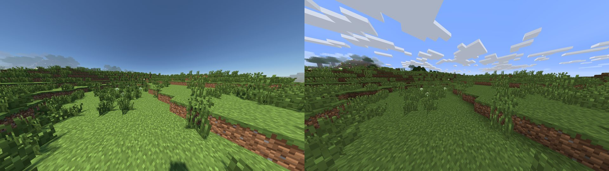 | Forest, low sun 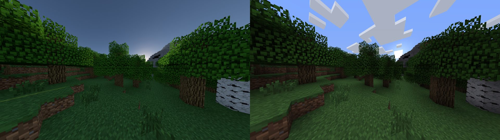 |
| Lake shore, noon 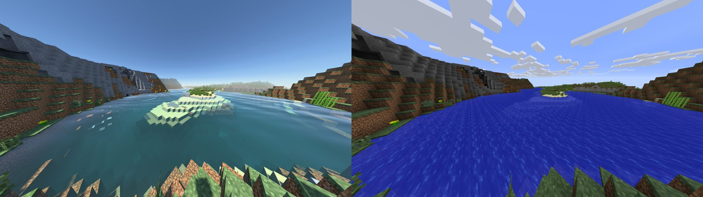 | Lake shore, sunset 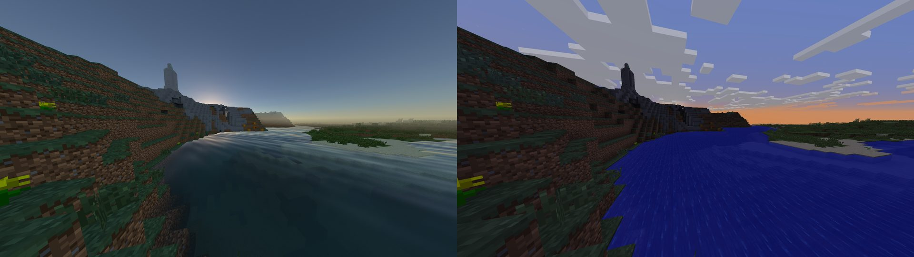 |
| Full moon 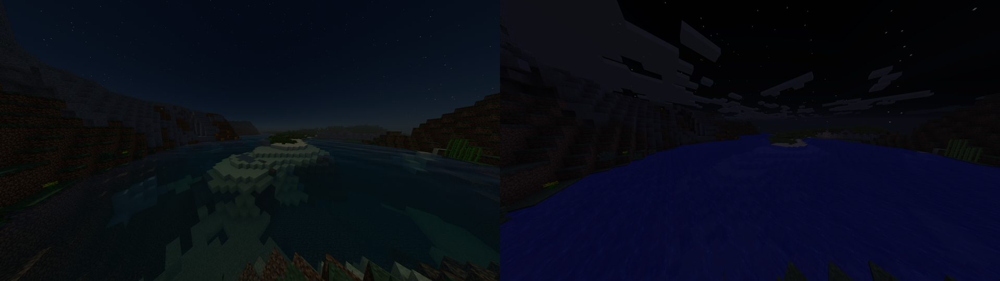 | New moon 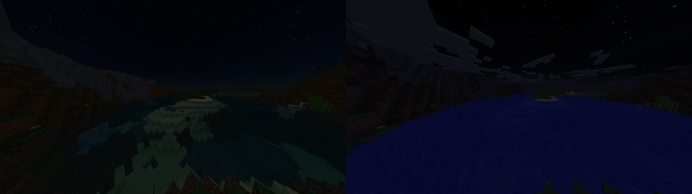 |
| Under the lake 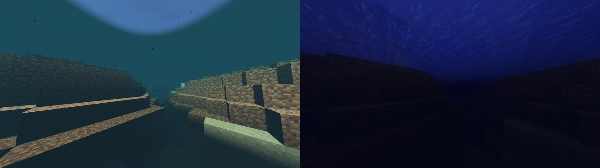 | Torch-lit tunnel, midnight 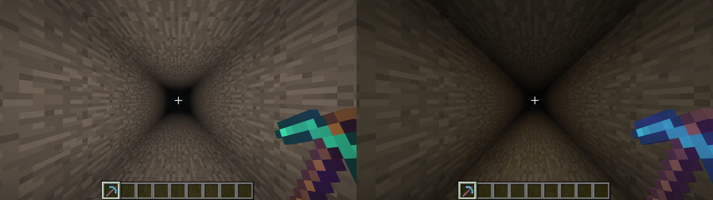 |
| Looking up at the full moon 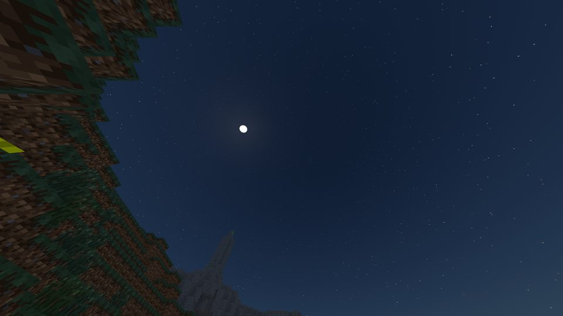 | Block gallery (bottom row: vanilla and Twilight Forest leaves) 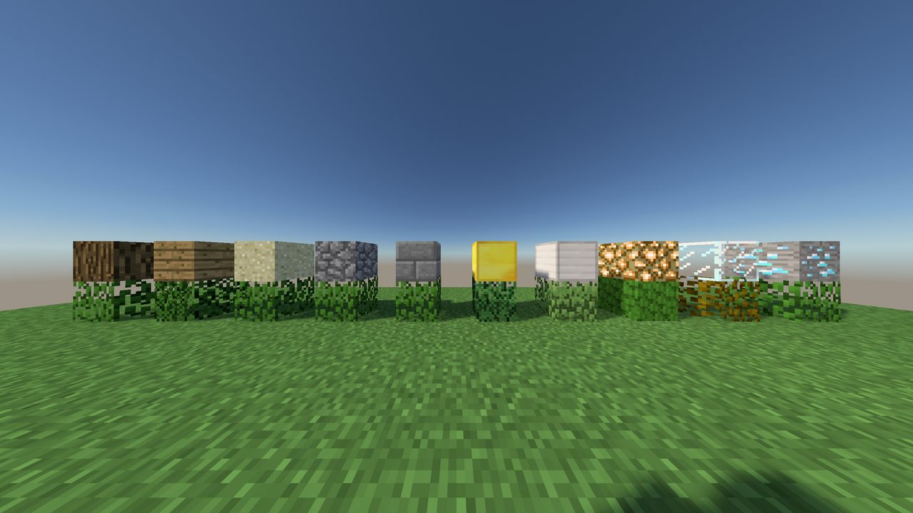 |

Low (1920×1080) and Potato (1280×720): plains, shore, full moon.

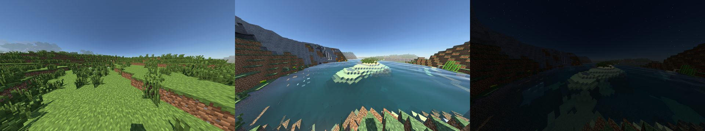
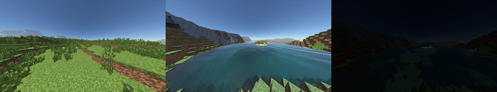

**The ID path, end to end** (milestone 1, item 7). The gallery wall in debug view 1:

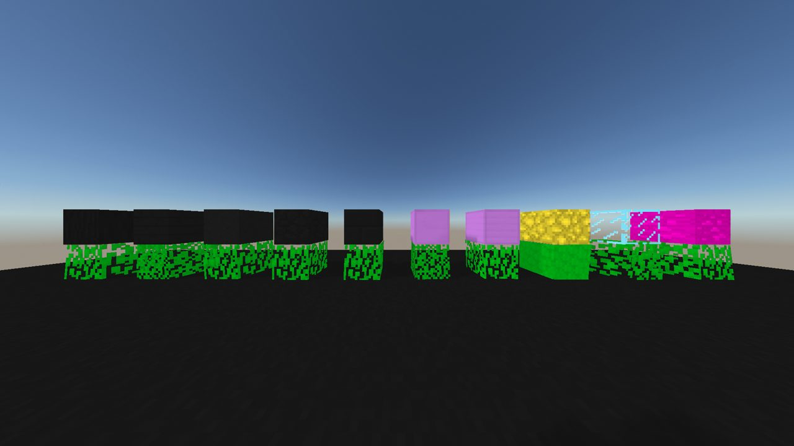

Every bottom-row block, vanilla and Twilight Forest leaves alike, reads as *leaves*
(green). The top row: gold and iron are metal (violet), glowstone is emissive (yellow),
glass is cyan and diamond ore is ore (magenta); log, planks, sand and stone carry no
special ID. Between two frames one tick apart, 42.5% of the leaf-row pixels change
(vanilla leaves 52%, Twilight Forest leaves 37%), against 1.9% for the static blocks
above (dither and TAA). The modded leaves wave from `block.properties` IDs that
`gen_surface_pack.py` generated. Frames: `C:\qfb\shaderdev
ounds\screenshotsench-leafid-leafview*.png`.

## Performance

Shader cost = the FrameBench p50 frame time with the pack, minus the same scene with
shaders off, in the same slim client at the same resolution, vsync off (`Frame pacing:
vsync off` in the log). Dev PC: RTX 5070 Ti, 7900X. Budgets come from
[`performance-rules.md`](performance-rules.md). The Low and Potato budgets are proxies for
a GTX 1060 and an Iris Xe until a friend's PC runs the pack.

| Preset | Resolution | Worst shader cost | Typical | Budget (dev PC) | Result |
|---|---|---|---|---|---|
| High (2048 map, 112 blocks, 8 taps, TAA) | 2560×1440 | **0.95 ms** (torch) | 0.56–0.67 ms | ≤ 3.0 ms (the Ultra row; High has no dev-PC row) | pass |
| Low (1024 map, 48 blocks, TAA) | 1920×1080 | **0.47 ms** (static) | 0.16–0.40 ms | ≤ 0.9 ms proxy | pass |
| Potato (no shadow pass, no TAA) | 1280×720 | **0.34 ms** (torch) | 0.16–0.31 ms | ≤ 0.4 ms proxy | pass, with little margin |

- **Whole frame on High at 1440p:** p50 0.9–1.4 ms (700–1,100 fps), 1% low 288–388 fps.
- **Frames over 33 ms:** 1 in the torch scene and 2 in the gallery, on every preset and
  also with shaders off. They come from chunk rebuilds as the scene loads, not the pack.
- **Potato's cost** is mostly the fixed-size sky tables in `prepare`, which don't shrink
  with resolution. Look there first if a real integrated GPU misses its budget.
- **CPU side not measured** (the shadow pass on a 4-core proxy, `run_bench_lo.ps1`). The
  slim trial has almost no entities, so it would say little. Measure it on the full pack
  at Low before release.

## Review rounds

Each round rendered High (1440p), Low (1080p) and Potato (720p) and ran `check_frames.py`.
A critic subagent then read the PNGs against the look bible: pixels only, with
Complementary and vanilla frames as reference.

| Round | What changed | Worst cost High / Low / Potato | Critic |
|---|---|---|---|
| r01 | First full render, after fixing the trial setup (below) | ~1.0 ms whole frame on High | not run; obvious faults: blue stone in shade, near-black nights, glowing cyan water |
| r02 | Ambient lifted, water in-scatter cut, night light raised | 0.93 / 0.47 / 0.36 ms | mean ~4: neon saturation, no shadows on High, no golden hour, black nights |
| r03 | Tone-mapper toe removed (saturation 0.82 → 0.53; vanilla 0.53). Shadows fixed (manual PCF in place of `shadowtex0HW`). Torch, haze, water | 0.97 / 0.46 / 0.36 ms | **6.1**: colour and shadows fixed; golden hour colourless, torch too bright, moon phase invisible |
| r04 | Night floor follows moon phase; partial adaptation; bigger moon and sun, stars; glint | 0.97 / 0.46 / 0.37 ms | not run; nights differed by preset, traced to the exposure meter |
| r05 | Exposure metered from level 0 (the mips were stale); floor on the adaptation factor | **0.95 / 0.47 / 0.34 ms** | **5.9**: stars, moon, glint, greyer torch better; golden hour still colourless. *This is the baseline.* |
| r06, r07 | Stochastic rounding of the stored exposure; meter moved to a `composite2` pass; ambient, torch, water tweaks; golden-hour views retimed | 0.95 / 0.48 / 0.33 ms | not run: exposure collapsed to near black on Low and Potato. **Reverted to r05.** |

Mean luma of the r05 High frames:

| Scene | Ours | Vanilla | Complementary |
|---|---|---|---|
| Plains | 0.43 | 0.46 | |
| Forest | 0.21 | | |
| Shore, noon | 0.43 | | |
| Sunset | 0.27 | | |
| Full moon | 0.064 | 0.037 | 0.067 |
| New moon | 0.042 | | |
| Torch tunnel | 0.28 | 0.17 | |

Mean saturation of the lower half of the frame matches vanilla on the plains (0.53 vs 0.53)
and in the torch tunnel (0.37 vs 0.37).

## Known issues

In the order to tackle them. The r05 critic's gate (every Tier A item at 7 or more,
nothing severe) does not pass yet; items 1–3 are why.

1. **Golden hour and sunset have no warmth** (critic: severe; Tier A item 4).
   - Partly the scenes. In Minecraft the sun meets the horizon near world time 12000.
     The r05 forest view (12000) and sunset view (12300) had the sun on or below the
     horizon, which renders as a cold dusk.
   - `views-world-master.txt` now uses 11450 and 11800, with the sun a few degrees up,
     where the transmittance table turns the light orange. It also adds a separate
     `shore_dusk` at 12300. No round has rendered these yet.
   - If it is still cold with the sun up, the sky ambient is too strong against the
     direct light at low sun. Try `AMBIENT_GAIN` 1.5 in `lib/lut.glsl`.
2. **Auto-exposure is not trustworthy yet.** Two faults were measured:
   - **(a) Updates freeze at high frame rates.** At 1000+ fps the per-frame exposure step
     is below half a half-float ULP, so the stored value stops moving. Potato's nights
     froze at about half brightness: exposure 4.3 against 9 on Low, with the same raw
     radiance.
   - **(b) The meter reads the scene too bright.** At night it reads about 0.012 against
     a true 0.0005. The likely cause is the wrong copy of the ping-ponged `colortex3`.
   - **What was tried.** Stochastic rounding (r06) fixed (a) and let exposure converge,
     so the wrong readings from (b) drove it to near black. Moving the meter into a small
     `composite2` pass right after `composite` (r07) did not cure it.
   - **Next step:** show the meter's own average in debug view 8 and compare it with the
     frame, before touching the rounding again.
   - Until then exposure mostly stays where it starts, which is why r05 looks calm.
3. **The torch-lit tunnel is too bright**: 0.28 against vanilla's 0.17, with too little
   falloff. Exposure (item 2) is probably part of it. The steeper falloff curve from r06
   (`pow(b, 3.2)`) is untested.
4. **Shallow water tints sand mint** and the sand glows at night; Potato's shallows look
   opaque (critic: moderate). The untested r06 change is less red absorption
   (`WATER_ABSORB` 0.085, 0.045, 0.04).
5. **Noon sun shadows are faint** because the ambient fills them. Same `AMBIENT_GAIN` knob.
6. **Moon**: a featureless disk with a halo, no texture. Stars are small and sparse.
7. **Under water**, Snell's window is a hard-edged flat ellipse, and suspended particles
   draw as dark squares (look-bible failure class 4).
8. **Enchantment glint** shows on held items but tints the diamond green. On worn armour
   it is lost under the deferred lighting.
9. **Dirt sides show a few blue texels**: grey texels lit by sky light alone. Minor.
10. **Not checked: the full pack** (all mods, entities, custom renderers, other dimensions)
    with this shader pack. Every round ran on the 9-jar slim trial, but the morning steps
    use `C:\qfb\client-ang2`, which runs the full pack, so expect surprises there first.
    The Psychedelicraft, jukebox and MCHeli failure classes are milestone-3 work.
11. **Temporal noise is untested.** `check_frames.py --auto-pairs` flags the still pairs,
    but leaves, grass and water animate between the two ticks. Render with
    `--opt QF_STILL=1` for a real noise number.

## Angelica problems found

Problems in Angelica 2.2.33 cost most of the night. The first three have workarounds in place.

1. **`shadowtex0HW` (the separate hardware-compare shadow sampler) gives wrong results.**
   Sunlit open ground read as fully shadowed on Low and High. Comparing against plain
   `shadowtex0` at the same coordinates was right (debug view 7). The pack does its own
   2×2 comparison with `texelFetch`, which needs nothing beyond GL 3.3. The README's
   platform note about `shadowtex0HW` should carry this caveat.
2. **A shader-cache miss at startup can crash the first world frame.** When Angelica
   has to transform the pack (first boot after an edit, or a new preset), Iris builds the
   pipeline before the game's last resource reload and again after it (`[Load #1]`, then
   `[Load #2]`). The rebuilt pipeline's full-screen quad then draws with no vertex buffer
   bound: `EXCEPTION_ACCESS_VIOLATION` in `glDrawArrays` from `CenterDepthSampler`.
   Complementary does the same. The failed boot fills the cache, so a second start
   works; `bench_round.py` retries automatically. F9 reloads in a running game were
   tested (two in one run) and do not crash. It is worth reporting upstream.
3. **Mipmaps of `colortex3` are not rebuilt for a read in `prepare`.** The exposure
   meter read stale mip levels (night exposure stuck near 9 on every preset). It now
   samples level 0 sparsely (32×18 texels). The meter still reads night brighter than
   the final frame's own average; buffer ping-pong (`shaderParityFlip`) is the likely
   reason, still to confirm (Known issues, item 2).
4. **Half-float persistent values freeze at high frame rates** (colortex5 is RGBA16F).
   See Known issues, item 2.

And one in the test setup, fixed in `trial.py`: an Angelica trial whose `config/` lacks
the files Angelica writes on its first boot (`mixingasm` lists, `angelica-compat.cfg`
and others) crashes in the same `glDrawArrays` with shaders on, because those files take
effect only on the next boot. `trial.py stage-angelica` now stages them as templates.
**`tools/angelica-client/build_angelica_client.py` has the same gap** on a fresh E7
install with no Angelica configs: it writes only the overlay keys. Worth a check before
friends install it.

## Rounds log (2026-10-18, afternoon session)

Costs are FrameBench p50 shader cost (pack minus shaders off), worst scene, High 1440p /
Low 1080p / Potato 720p, against 3.0 / 0.9 / 0.4 ms. Luma is the High frame's mean
(sRGB). The gate: every Tier A item at 7 or more from the critic, nothing severe.

| Round | Change | Worst cost H / L / P | Critic | Result |
|---|---|---|---|---|
| r05 | baseline (de03f9f) | 0.95 / 0.47 / 0.34 | 5.9 | gate fail |
| r06, r07 | stochastic rounding; meter in composite2 (night session) | 0.95 / 0.48 / 0.33 | not run | reverted |
| d8, d9 | debug view 8 readout: the meter matches the frame within 0.02 stops (the "20x" theory was wrong); final read a colortex5 1-26 frames old, and prepare did not read its own last output | diagnostic | – | – |
| r08 | `prepare1` second write of colortex5 (even flip count); exposure stored as log2 in hi/lo halves; meter blends log-average with mean; vanilla-like torch falloff `pow(b,4.2)`; water red absorption 0.13 to 0.075; Snell's window with refracted sky and Fresnel; less sky fill at low sun; `golden_lit` view added | 0.96 / 0.48 / **0.44** | not run | exposure adapts at last, which lifted nights to 0.186 (3x Complementary) and the torch tunnel to 0.40; Potato torch over budget (the 576-read meter on one thread) |
| r09 | log-space exposure curve (partial adaptation below daylight); sky-view horizon bug fixed (`pi/2 + beta` to Hillaire's `pi - beta`); meter split over 32 column texels | 0.94 / 0.60 / not run | **5** (darkness 4, exposure 7, colour 6, golden 5, stability 7, near field 7) | torch tunnel 0.195 (vanilla 0.17): done. Nights too dark (0.038; new moon 22% crushed, severe). Hard tan band under the horizon. Potato run failed to start (0xC0000142) while another session held the slot |
| r10 | +1.5 stops under open sky at night (eye sky light), deeper slope below full moon; sky clamped at the horizon (no ground colour in haze); golden views retimed (the sun was 14-19 deg up, not 3-8: Minecraft eases the celestial angle; horizon at 12785); debug view 9 (colortex5 raw) | 0.93 (1.03 static while another session's server ran) / 0.48 / **0.37** | **6** (darkness 7, exposure 7, colour 6, golden 5, stability 7, near field 7) | nights 0.085 / 0.065, no crush (severe fixed); sunset has a warm horizon band; forest golden sat in the ridge's shadow and low-sun shade read murky; all budgets pass |
| r11 | night lift 1.5 to 0.8 stops; no low-sun ambient cut; Mie 1.5x (low-sun glow); warmer block light (1.0, 0.70, 0.45); softer Snell's window rim with ripple shading; forest_golden 12150, golden_lit 12250. High only: paused for the calibration set | 0.91 / – / – | not run | nights 0.060 / 0.045, torch 0.117 (warmer light read darker) |
| cal | owner's taste survey: 15 slim runs, 36 frames, one `QF_CAL_*` option per question (`tools/shaders/review/calibration.py`); owner answered round 0 the same afternoon (look-bible taste profile) | – | – | – |
| r12 | owner's answers: night lift 0.3 (between "truly dark" and "moonlit"), night distance fade into the night sky (from 14 blocks, 1/40), block light 0.95 to 1.1 | 0.92 / 0.48 / 0.37 | **6** (darkness 5, exposure 7, colour 6, golden 5, stability 7, near field 6) | nights 0.050 / 0.034, torch 0.202. Potato new moon 18% crushed (major). Night fog hides the full-moon mountain but not the new-moon one (backwards). Golden foreground still in murky shade |
| r13 | exposure slope below full moon 0.8 to 1.0; dusk lift (+0.6 stop x sin(pi x darkness), open sky only); golden_lit camera raised to y 84 | 0.92 / 0.49 / failed to start twice (cache-miss crash, then a pack change during the retry) | not run | golden_lit 0.341 with a warm-lit ridge and long shadows; new moon 0.95% crushed on High |
| r14 | night fade from 20 blocks at 1/64, towards a darker sky (x0.45), so silhouettes stay | **0.93 / 0.47 / 0.36** | **6** (darkness 6, exposure 6, colour 6, golden 5, stability 7, near field 6) | nights 0.047 / 0.043, torch 0.20 on all three presets, all budgets pass. Fails: new moon crushes on Low (7%) and Potato (4.5%), and the moon phase barely shows on High; forest_golden and shore_sunset still read cool; beige horizon haze in golden_lit; lime grass at noon |

**Where it stands after r14 (stopped at the round limit; gate not passed).** The best Tier A
scores reached are 7 for darkness (r10), exposure (r09, r10, r12), stability and near field; golden hour is
stuck at 5. The critic's consistent asks, in order:

1. **Golden hour:** warm amber light on whatever the low sun reaches, and gold sky within
   about 20 degrees of the sun (it reads grey-white). The direct light is physically
   orange (transmittance at 5.7 deg is about (1, 0.49, 0.13)), so look at the tone mapper's
   highlight desaturation near the sun, and at the grey-mauve sky above the band (ozone, multi-scatter).
2. **New moon:** keep a visible phase difference. Raise the ambient floor on Low and Potato
   rather than lifting exposure, which cancels the phase on High.
3. **Haze:** the 1.5x Mie gives a beige wall at the horizon at golden hour. The owner wants fog
   per biome, so tie Mie and haze density to biome or weather, not one global value.
4. Lime grass at noon (neutral colour), the featureless moon, black underwater particles, and Potato's murky underwater.

The scene set also misleads: forest_golden faces a sun hidden behind a ridge at every
tried time. The torch scene's held light (Torchlight enchantment) varies run to run; its
brightness swung between 0.12 and 0.20 with the same code.

## Rounds log (2026-10-19)

Shader Lab **round 1 (r001)** posted at 11:00: golden hour (A amber, B amber + gold sky,
C current), full- and new-moon nights (darker, current, brighter), haze strength (current, crisp,
moody, blizzard) and the torch tunnel, each with its cost and a critic note
(https://marionwhite.github.io/quest-forge/shaders/?r=r001). Every option costs the same
within noise (0.52-0.63 ms on High; torch 0.94). Defaults are unchanged by r001 until the
owner answers; the work below is the critic's open list.

| Round | Change | Cost H / L / P (worst) | Critic | Result |
|---|---|---|---|---|
| a1 | r001 variants (`QF_CAL_GOLD`, `QF_CAL_FOG`, `QF_EXPOSURE_BIAS`); shaders-off baseline a1off at 1440p for every r001 scene | 0.94 (torch) | 5 (darkness 6, exposure 5, colour 7, golden 5, stability 8, near 6) | posted as r001. Haze critic: current 7, crisp 7, moody 2, blizzard 3 (fog stopped at the sky) |
| a2 | **Moon phase.** Debug view 8: the meter read the new moon 2.1 stops darker and exposure rose 1.95 stops (`EXPO_DEEP_SLOPE` 1.0), so new-moon land was *brighter* than full-moon land. Slope 0.6 (`QF_DEEP_SLOPE`), night floor no longer halved at new moon, 1.25x floor on Low and Potato. **Moon disk** drawn at 60x `MOON_I` clipped 98% white; now `QF_MOON_GAIN` 7 with maria, mottling and limb | 0.58 / 0.14 / 0.32 | – | new-moon land 0.046 vs full 0.050; land crush 4.4 / 4.4 / 7.6% |
| a3 | **Fog modes** in composite: crisp (haze x0.2), moody (exponential height fog from the water line, H 7 blocks) and storm (sight ~40 blocks), lit as a medium (sky dome + sun or moon with a forward lobe + night floor) and covering the sky too. `QF_BIOME_FOG` drives them from smoothed custom uniforms (`biome_category`, `biome_precipitation`, `rainStrength`; Angelica defines `CAT_*` and `PPT_*`); **off by default** until the owner answers r001's haze question. Biome tints pulled less yellow (`QF_TINT_SAT` 0.85, `QF_TINT_RED` 0.92): noon grass hue 86 -> 94 deg, saturation 0.53 -> 0.45. Potato sun stand-in `smoothstep(0.55, 0.92)` (0.80 left lake beds unlit). `forest_lit` camera | 0.62 / 0.41 / – | moody 6 (was 2), storm 5 (was 3) | moody pools in valleys, the ridge and near field stay clear |
| a4 | **Underwater particles** were dark specks: particle quads have no usable normal; lit as facing up (Potato dark specks 75 -> 6). Potato underwater uses a lower sun ramp. Full High scene set + Low | 0.93 torch / 0.41 / – | **6.5** (r14: 6): darkness 6, exposure 7, colour 7, golden 5, stability 8, near 7 | moon disk and particles fixed; new-moon *sky* crushed (22% at luma <= 2) |
| a5-a7 | **Airglow**: `QF_AIRGLOW` 0.004 x `MOON_I`, brighter towards the horizon (1.6x on Low and Potato, whose 12-step sky table draws the night zenith ~30% darker), so a moonless sky is deep blue-black, not black | **0.63 / 0.21 / 0.30** | – | `check_frames` passes on all three presets. Full / new moon mean luma 0.050 / 0.034 (High), 0.049 / 0.034 (Low), 0.047 / 0.032 (Potato), crushed <= 0.01% (a4h new moon was 22.5%) |

Traps found today:
- `trial.py launch` re-copies the repo pack on **every** launch, including `bench_round.py`'s
  cache-miss retry. An edit between the two launches gives a second cache miss and a second
  crash (a4p).
- The static scene's warm pool near the hand is the held-light term (the Torchlight enchant),
  and it varies run to run (none in r14h, faint in a1c, strong in a3m). It is not a gravel specular.
- The storm preview (`QF_CAL_FOG=4`) runs without rain, so the sun and its water glints stay at
  full strength through the fog. Driven by biome, the storm weight is `rainStrength`, which
  already dims the sun.

Still open (critic, a4): golden hour 5 (warm directional light on lit foreground and leaves;
the beige band at the horizon is the sky table's Mie glow); the torch scene has no torches
in view, only the held light; no clouds; the enchantment glint is missing on the held pickaxe;
a thin dark seam under the forest canopy.

## Rounds log (2026-10-21): r001 answered, r002 posted

The owner answered r001 (issue #2, `feedback/r001.json`; folded into the look bible's taste
profile). Costs are p50 shader cost against shaders-off baselines off2h/off2l/off2p (worst scene),
budgets 3.0 / 0.9 / 0.4 ms.

| Round | Change | Cost H / L / P | Critic | Result |
|---|---|---|---|---|
| b1-b4 | test renders: `torch_wall` (new FrameBench scene, wall torches only), `lake_glow` (out on the lake; `auto` put the camera under water), `night_sky` | – | – | the beige wall is gone with the horizon floor; Milky Way invisible at 2-4x airglow |
| c | defaults: `QF_CAL_GOLD` 2 (peach pull only above the horizon band), `QF_HORIZON_FLOOR` (below-horizon sky fades to a darker, cooler veil), `QF_HAZE` 0.6, `QF_TORCH_WARM` 2 (3000 K core to 2400 K edge, luminance-matched to r001), `QF_WATER_STYLE` 1 (SSR on Medium+ at 12/20 steps, glitter path, wind ripples), `QF_NIGHT_SKY` 1 (denser stars, Milky Way), `QF_BIOME_FOG` 1 (crisp hills, swamp moody 0.35, snow storm); variants cv1-cv5 | **0.95 / 0.45 / 0.34** | **6.9** (golden_lit 7.5, night_full 8, torch B 8) | SSR costs ~0.25 ms on High. Weak: sunset water and sky, no amber on forest blocks |
| d | glitter core back at full strength (0.6x had dimmed the path); Milky Way tilted, tinted, 1.75x; wider haze and new-moon spreads | 0.89 / – / – | **6.5** on the water/sky set | posted as **r002** (11 questions). Sunset water still below r001's B on the right half (critic) |

Open after r002 (critic): sunset/dawn sky reads grey-lavender above the band, so even good
reflections mirror cold colour; near water at sunset is dark; forest blocks get almost no amber
at golden hour; the haze options are nearly indistinguishable on golden_lit; Potato's new moon is
0.027 with 1.5% crushed; Milky Way dust lanes look like beads.
